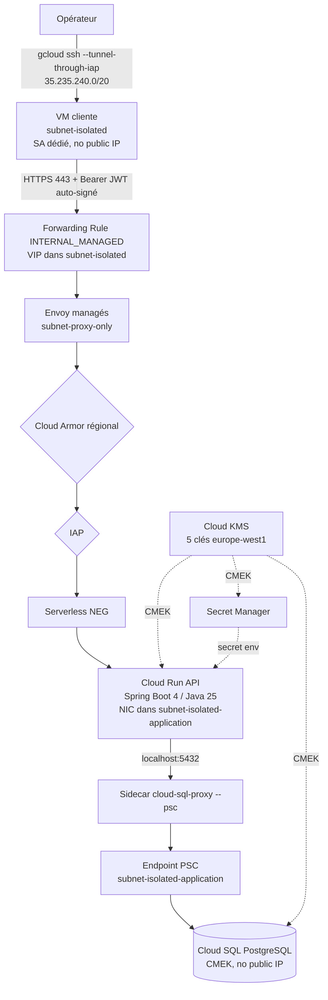

# 🔒 ALB Internal — Regional Internal ALB + IAP + Cloud Armor + CMEK

> [📚 Consulter la documentation Terraform auto-générée (TFDOCS.md)](./TFDOCS.md) · [infra/bootstrap TFDOCS](./infra/TFDOCS.md)

API **Spring Boot 4 / Java 25** sur **Cloud Run**, écrivant dans une base **Cloud SQL PostgreSQL**, exposée **uniquement en interne** via un **Application Load Balancer régional interne** protégé par **Cloud Armor** et **IAP**, chiffrée de bout en bout en **CMEK (Cloud KMS)**, isolée par des règles de pare-feu **deny-by-default** par service account / tag réseau.

> [!IMPORTANT]
> **Ce sample n'a pas été déployé.** Tout le code (Terraform, application, tests) a été écrit et validé **hors-ligne** (`terraform validate`, `terraform test` avec `mock_provider`, `pre-commit`) — voir [Statut de vérification](#-statut-de-vérification) ci-dessous pour ce qui reste à confirmer par un vrai `terraform apply`, en particulier le point 0 (IAP sur ce type de backend).

## ✨ Features

- VPC dédié (3 subnets : `subnet-isolated`, `subnet-isolated-application`, `subnet-proxy-only`), aucune dépendance à `samples/base`.
- ALB régional interne (`INTERNAL_MANAGED`) → Cloud Armor régional (WAF CRS 4.22 + parsing JSON + rate-based ban) → IAP → NEG serverless → Cloud Run.
- Cloud Run (Spring Boot 4.0.8 / Java 25) sur une image runtime **Docker Hardened Image**, avec sidecar **Cloud SQL Auth Proxy** (`--psc`).
- Cloud SQL PostgreSQL 17, connectivité privée via **Private Service Connect**, endpoint placé littéralement dans `subnet-isolated-application`.
- **CMEK** (Cloud KMS) sur Cloud SQL, Cloud Run, Artifact Registry, Secret Manager, disque de la VM cliente — 5 clés, rotation 90 jours.
- Pare-feu **deny-by-default** : allow ciblés par service account (VM) ou tag réseau (Cloud Run).
- VM cliente sans IP publique (accès SSH via tunnel IAP) et tests E2E automatisés (`task e2e`, `task e2e-cyber`).
- 100 % Terraform (2 stacks : `infra/bootstrap` create-once, `infra/` destructible) + Taskfile + tests `terraform test` hors-ligne.

## 🏗️ Architecture



### Key Design Decisions

| Décision | Choix | Justification |
|---|---|---|
| Région | `europe-west1` (Belgique) | Demande explicite. Surcharge locale du `.env` racine (`europe-west9`) via `REGION_BE` dans le Taskfile. |
| Exposition | ALB régional **interne** + Cloud Run `INGRESS_TRAFFIC_INTERNAL_LOAD_BALANCER` | Aucune IP publique. L'URL `run.app` par défaut est injoignable depuis Internet. |
| Sous-réseaux | 3, pas 2 : `subnet-isolated`, `subnet-isolated-application`, `subnet-proxy-only` | L'ALB régional interne (Envoy) exige un subnet `REGIONAL_MANAGED_PROXY` — non négociable côté GCP, n'héberge aucune charge applicative. |
| AuthN/AuthZ | IAP activé sur le backend service, **client OAuth Google-managé** (pas de `google_iap_client`) | L'API IAP OAuth Admin utilisée par `google_iap_client` a été définitivement fermée le 2026-03-19. Voir [Écart vs. plan.md](#️-écart-vs-planmd--dépréciation-iap-oauth-admin-api) et Security Design. |
| WAF | Cloud Armor **régional** (`type = CLOUD_ARMOR`), `provider = google-beta` | `security_policy` sur `google_compute_region_backend_service` n'existe qu'en `google-beta` à la version de provider épinglée (`~> 6.0` → 6.50.0). |
| Rulesets WAF | **CRS 4.22** (`-v422-stable`), pas CRS 3.3 | CRS 3.3 n'inclut **pas** le ruleset `java` (« Not included » dans la doc Google) — le plus pertinent pour une stack Spring Boot (désérialisation, Log4Shell). |
| Sensibilité WAF | `evaluatePreconfiguredWaf(..., {'sensitivity': 1})` | `evaluatePreconfiguredExpr()` hérite du défaut implicite **sensibilité 4** (paranoia level 4 OWASP, toutes signatures) — trop bruyant. Reco Google : démarrer au niveau 1. Chaque ruleset retenu a ≥ 1 signature de niveau 1. |
| Parsing du corps | `json_parsing = "STANDARD"` | L'API ne parle que JSON. Au défaut (`DISABLED`), le corps est évalué comme une **chaîne plate** → faux positifs sur les caractères structurels JSON **et** contournements SQLi encodés en JSON. |
| Rate limiting | `rate_based_ban`, pas `throttle` | Un simple `throttle` laisse l'attaquant sonder **indéfiniment** à exactement 100 req/min — le scénario d'énumération lente depuis une VM compromise. |
| Accès BDD | Cloud SQL Auth Proxy en **sidecar** Cloud Run (`--psc`) | Tunnel mTLS + autorisation IAM, aucune exposition réseau directe de Postgres. |
| Identité BDD | Utilisateur **built-in** + mot de passe en Secret Manager (CMEK) | Flyway a besoin de droits DDL (propriétaire du schéma) ; un utilisateur IAM SA ne possède pas le schéma `public` en PG15+. |
| Migrations DB | `FlywayMigrationRunner` (`ApplicationRunner` custom, pas d'auto-configuration) | **Spring Boot 4.0 ne fournit plus de module d'auto-configuration Flyway** (`spring-boot-starter-flyway` n'existe pas) : `flyway-core` n'est qu'un moteur, rien n'appelle `migrate()` tout seul, donc `spring.flyway.*` n'a aucun effet. Migration explicite au démarrage via le `DataSource` de l'app, avant que la readiness probe ne puisse passer. |
| DB privée | **Private Service Connect** (pas Private Service Access) | Seule façon de placer littéralement l'endpoint de connectivité dans `subnet-isolated-application` (avec PSA, l'instance vit dans une plage peerée hors VPC). |
| Chiffrement | CMEK sur Cloud SQL, Cloud Run, Artifact Registry, Secret Manager, disque VM | 5 clés distinctes = séparation des périmètres de révocation. Rotation 90 jours. Key ring **indestructible** → stack `infra/bootstrap` séparée. |
| Pare-feu | `deny all` ingress+egress, puis allow par **service account** (VM) et **tag réseau** (Cloud Run) | `target_service_accounts` ne s'applique qu'aux NIC de VM ; Cloud Run en Direct VPC Egress ne supporte que les tags réseau. |
| Sortie Internet | **Aucun Cloud NAT** | Isolation maximale. Conséquence : `gcloud`/API Google réelles injoignables depuis la VM — voir Security Design. |
| Terraform | 2 stacks (`infra/bootstrap` + `infra/`), sample **autonome** (pas d'`impersonate_service_account`) | Le key ring KMS n'est jamais supprimable dans GCP. Le VPC est propre au sample, pas partagé avec `samples/base`. |

## ⚠️ Écart vs. `plan.md` : dépréciation IAP OAuth Admin API

`plan.md` (§2.2, §5 ligne 0) prévoyait un `google_iap_client` dédié pour minter un jeton OIDC d'audience = `client_id` depuis le serveur de métadonnées de la VM cliente. **Ce n'est plus possible** : l'API IAP OAuth Admin a été dépréciée le 2026-01-22 et **définitivement fermée le 2026-03-19** (source : [Migrate from the IAP OAuth Admin API](https://docs.cloud.google.com/iap/docs/deprecations/migrate-oauth-client)). `terraform validate` confirme que la ressource `google_iap_client` est marquée deprecated par le provider.

Conséquence, appliquée dans ce sample :

- `iap.tf` ne déclare plus de `google_iap_client`. Le bloc `iap { enabled = true }` (`loadbalancer.tf`) omet `oauth2_client_id`/`oauth2_client_secret` : IAP utilise alors automatiquement le **client OAuth Google-managé**.
- Le client OAuth Google-managé **ne permet pas** de minter un jeton d'identité OIDC via le serveur de métadonnées (`?audience=<client_id>`) — cette voie programmatique n'existe que pour un client OAuth personnalisé.
- À la place, le test E2E (`task e2e`) utilise la voie officiellement documentée pour les comptes de service : un **JWT auto-signé** (`iss`/`sub` = SA de la VM cliente, `aud` = URL de l'API + `/*`), signé via l'API IAM Credentials (`projects.serviceAccounts.signJwt`) — **depuis la machine de l'opérateur**, jamais depuis la VM (dont le pare-feu `deny-all-egress` bloque `iamcredentials.googleapis.com`). La VM ne fait que présenter ce JWT déjà signé au VIP de l'ILB. Voir `iam.tf` (`google_service_account_iam_member.operator_token_creator`) et `Taskfile.yml` (tâche `e2e`).
- **`task e2e` doit être exécuté par l'identité `TF_VAR_iap_user_email`** (via `gcloud auth login` local) : c'est la seule identité à détenir `roles/iam.serviceAccountTokenCreator` sur le SA de la VM cliente (`iam.tf`), donc la seule à pouvoir minter le JWT ci-dessus. `task e2e-cyber` (Cloud Armor) ne nécessite pas de JWT : le WAF/rate-limit est évalué avant IAP.

> [!NOTE]
> `plan.md` était le document de conception initial de ce sample (10 phases d'exécution, voir `CHANGELOG.md`) — un scratch de travail intentionnellement non versionné, absent de ce dépôt. Les numéros de section cités ci-dessus et dans la section suivante restent comme trace historique de la déviation ; le comportement qu'ils décrivent est intégralement vérifiable dans le code actuel (`iap.tf`, `loadbalancer.tf`, `iam.tf`).

## 🔍 Statut de vérification

Ce sample a été **entièrement écrit et vérifié hors-ligne**, jamais déployé (voir `AGENTS.md` — FinOps : provisionner des ressources facturables nécessite un accord explicite préalable).

| Vérifié hors-ligne | Non vérifié (nécessite un vrai `apply`) |
|---|---|
| `terraform validate` (les deux stacks) | **Point le plus critique** : `iap { enabled = true }` sur un `google_compute_region_backend_service` **régional**, backend **NEG serverless** — l'API GCP accepte-t-elle réellement cette combinaison ? Aucune doc consultée ne le confirme noir sur blanc (`plan.md` §5 ligne 0). Fallback documenté : IAP natif sur le service Cloud Run lui-même. |
| `terraform test` (10/10 `pass`, `mock_provider`, zéro credential) | Acceptation API des règles Cloud Armor préconfigurées WAF + `rate_limit_options` sur une policy **régionale** attachée à un ALB **interne**. |
| Matrice de support Cloud Armor régional (WAF, managed rules, body filtering, rate-based ban, request logging = supportés) vérifiée sur la doc officielle | Que Cloud Armor voie bien l'**IP client d'origine** et non l'IP Envoy de `subnet-proxy-only` : la règle 900 matche `src_ip_ranges = [subnet-isolated]`. Si c'était l'IP du proxy, **tout** tomberait dans le deny-all 2000 et le sample serait entièrement cassé. `task e2e-cyber` le valide implicitement (les 302 attendus reviendraient en 403). |
| Niveaux de sensibilité par ruleset CRS 4.22 (chaque ruleset retenu a ≥ 1 signature de niveau 1, donc `sensitivity: 1` ne le vide pas) | Que `resource.type = "internal_http_lb_rule"` soit bien le type des logs Cloud Armor d'un ALB **interne** (la doc « request logging » ne décrit explicitement que les ALB externes) — sinon les métriques de `monitoring.tf` resteront vides. |
| `terraform fmt -recursive` | Le tag exact `dhi.io/maven:3.9-jdk25-alpine3.23-dev` / `dhi.io/eclipse-temurin:25-alpine3.23` (confirmés via le catalogue DHI le 2026-09-19, mais nécessitent `docker login dhi.io` pour être tirés). |
| Recherche primaire (fetch direct des pages Docker Hub / docs.cloud.google.com / source Go du provider) pour chaque déviation ci-dessus | Le flux JWT auto-signé end-to-end contre IAP (le mécanisme est documenté par Google, mais jamais exercé ici contre une vraie ressource IAP). |

**Avant tout `task apply`** : appliquer isolément `loadbalancer.tf` + `armor.tf` + `iap.tf`, vérifier `gcloud compute backend-services describe --region europe-west1` → `iap.enabled: true`. Si l'API rejette la combinaison, basculer sur le fallback IAP natif de Cloud Run (voir `plan.md` §5).

## 🔒 Security Design

- **Aucune IP publique** nulle part (Cloud Run, Cloud SQL, VM cliente) ; le seul point d'entrée réseau est le VIP interne de l'ALB (`subnet-isolated`).
- **IAP** protège le backend service ; `roles/run.invoker` sur Cloud Run est accordé au **service agent IAP** (`service-<PN>@gcp-sa-iap.iam.gserviceaccount.com`), pas à `allUsers`.
- **Cloud Armor régional** : 8 rulesets WAF préconfigurés **CRS 4.22** (SQLi, XSS, RCE, **Java/Log4Shell**, protocol attack, method enforcement, CVE Log4j, scanner detection en `preview`) à **sensibilité 1** explicite, **parsing JSON du corps de requête**, **rate-limit + ban** (100 req/min/IP, ban 10 min au-delà de 600 req/5 min), allowlist `subnet-isolated`, deny explicite par défaut. Voir [Modèle de menace](#-modèle-de-menace-cloud-armor).
- **Pare-feu deny-by-default** : `deny-all-ingress`/`deny-all-egress` à la priorité 65533, puis 3 allow ciblés. **Conséquence assumée** : la VM cliente ne peut atteindre ni `logging.googleapis.com` ni aucune API Google réelle (seuls le serveur de métadonnées et le VIP de l'ILB sont joignables) — son service account **ne reçoit donc aucun rôle projet inutilisable** (pas même `roles/logging.logWriter`). Pour un accès `gcloud` complet depuis la VM : règle egress vers `199.36.153.8/30` + zone DNS privée `googleapis.com.` (non implémenté, voir « Pour aller plus loin »).
- **CMEK partout** : 5 clés Cloud KMS séparées (Cloud SQL, Cloud Run, Artifact Registry, Secret Manager, disque VM), rotation 90 jours, key ring **volontairement indestructible** (`prevent_destroy`) dans une stack bootstrap séparée.
- **IAM least-privilege** : SA dédié par workload (`alb-internal-api`, `alb-internal-client`), aucun rôle `editor`/`owner`, accès au secret DB scopé au secret (pas au projet).
- **Secret en state** : `random_password` (mot de passe DB) vit dans le state Terraform (chiffré côté GCS). En production, générer hors-bande + seeder `google_secret_manager_secret_version` manuellement.
- **Certificat TLS auto-signé** : les certificats Google-managed régionaux exigent Certificate Manager + une autorisation DNS **publique**, impossible pour un hostname purement interne (`api.alb-internal.internal`). `curl -k` est donc nécessaire. En production → Certificate Manager régional avec un domaine réel.
- **Aucun secret ni identifiant réel** dans ce dépôt (placeholders `my-gcp-project-id`, `admin@example.com`).

## 🎯 Modèle de menace Cloud Armor

Le VIP de l'ALB n'est joignable que depuis `subnet-isolated`, et le pare-feu est deny-by-default. **Cloud Armor n'est donc pas ici un bouclier anti-Internet** : sa valeur réelle est contre un attaquant **déjà dans le VPC** (VM cliente compromise, insider, dépendance malveillante). C'est ce critère qui a décidé des rulesets activés — et de ceux écartés.

### Plan de priorités

Cloud Armor s'arrête à la **première règle qui matche**. La règle 900 sert à la fois de rate-limit **et** d'allow pour `subnet-isolated` : toute règle WAF déclarée au-dessus de 900 serait donc du **code mort**.

> [!IMPORTANT]
> Cet invariant est verrouillé par un test (`waf_rules_are_evaluated_before_the_allow_rule` dans `infra/tests/unit.tftest.hcl`), qui échoue si une règle WAF est ajoutée à une priorité ≥ 900.

```text
100–299   deny explicites (bannissements manuels) — inutilisé
300–499   rulesets WAF en `preview` (journalisés, non bloquants)
500–899   rulesets WAF appliqués
900       rate-limit + ban + allow subnet-isolated
2000      deny-by-default
```

### Rulesets activés

| Priorité | Ruleset (CRS 4.22) | Mode | Pourquoi |
|---|---|---|---|
| 400 | `scannerdetection-v422-stable` | **preview** | Signature unique « user-agent associated with security scanner ». Les tests `task e2e`/`e2e-cyber` interrogent l'API avec **curl** : risque de faux positif non vérifiable hors-ligne → on observe avant d'appliquer. |
| 500 | `sqli-v422-stable` | appliqué | Inclut la signature 942550 « JSON-Based SQL injection » dès le niveau 1. |
| 510 | `xss-v422-stable` | appliqué | Surface réduite (API JSON) mais coût nul. |
| 520 | `rce-v422-stable` | appliqué | Exécution de code à distance. |
| 530 | `java-v422-stable` | appliqué | **Le plus pertinent ici** : désérialisation Java (CVE-2015-4852), Struts (CVE-2017-9805), Log4Shell (944150). Absent de CRS 3.3. |
| 540 | `protocolattack-v422-stable` | appliqué | Request smuggling / response splitting — pertinent vu la chaîne de proxies Envoy managés. |
| 550 | `methodenforcement-v422-stable` | appliqué | L'API n'expose que `GET` et `POST`. |
| 560 | `cve-canary` | appliqué | Complète `java` sur Log4Shell : signatures Google 044228/144228 (obfuscation et contournements). |

### Rulesets volontairement écartés

| Ruleset | Raison |
|---|---|
| `lfi` / `rfi` | Aucun service de fichiers, 2 endpoints REST. |
| `php` / `nodejs` | Stack Java. |
| `sessionfixation` | Pas de session applicative, IAP en amont. |
| `json-sqli-canary` | Couverture largement recouverte par la signature 942550, **déjà incluse au niveau 1** dans `sqli-v422-stable`. La variante canary est un peu plus large (vecteurs SQLi dans l'URL) mais ne justifie pas une règle facturée de plus. |

### Non disponible sur une policy régionale

Matrice officielle, colonne *Regional internal Application Load Balancer* — inutile de les chercher : **Adaptive Protection**, **Google Threat Intelligence**, **bot management / reCAPTCHA / action `redirect`**, **géographie client**, **ASN client**, **Address Groups**, **Security Command Center**.

### Détection

`log_config` est déjà actif à 100 % sur le backend service : les logs Cloud Armor existent et sont déjà payés. `monitoring.tf` en fait deux métriques log-based (`armor-denied` pour les règles appliquées, `armor-preview-matched` pour la bande `preview`) et une alerte au-delà de 50 blocages / 5 min. Le label `rule_priority` distingue un blocage WAF (500–899) d'un dépassement de rate-limit (900) ou d'une source non autorisée (2000).

> [!TIP]
> Les canaux de notification sont pilotés par `alert_notification_channels` (vide par défaut : la policy d'alerte est créée et visible en console, mais ne notifie personne).

## 📋 Prerequisites

- `terraform`, `task`, `podman`, `pre-commit`, `gcloud` installés (`task init` à la racine du dépôt).
- `gcloud auth application-default login` effectué ; `.env` renseigné (`PROJECT_ID`, `TF_VAR_iap_user_email`).
- **Docker Hardened Images** : `docker login dhi.io` (ou `podman login dhi.io`) nécessite une souscription DHI.
  - Sans souscription : fallback vers `docker.io/maven:3.9-jdk25` (builder) + `docker.io/eclipse-temurin:25-jre-alpine` (runtime) via les variables d'environnement `DHI_BUILDER_IMAGE` / `DHI_RUNTIME_IMAGE` du `.env`.

## 🚀 Deployment

```bash
# 1. Ressources create-once : GCS state bucket, KMS, Artifact Registry
task bootstrap

# 2. Build + push de l'image API (Docker Hardened Image)
task build

# 3. Déploiement de la stack principale (VPC, Cloud SQL, Cloud Run, ALB, Cloud Armor, IAP, VM cliente)
task apply

# 4. Test E2E : 302 sans jeton, 201 puis 200 avec un JWT auto-signé
task e2e

# 4bis. Test E2E sécurité : Cloud Armor (WAF query string + corps JSON + rate-limit)
task e2e-cyber

# 5. Destruction de la stack principale (jamais bootstrap)
task destroy
```

> [!WARNING]
> `task destroy-bootstrap` détruit le key ring KMS et Artifact Registry. **Le key ring et ses clés ne peuvent pas être réellement supprimés côté GCP** (ils passent en état "scheduled for destruction" puis restent résiduels, coût négligeable < 1 €/mois). Pour repartir de zéro proprement, changer `name_suffix` (ex. `-sample2`) plutôt que de recréer le même nom.

## 🧰 Task Commands

| Command | Description |
|---|---|
| `task setup` | Crée le bucket GCS d'état (idempotent) |
| `task bootstrap` | Crée KMS + Artifact Registry (`infra/bootstrap`, jamais détruit par `task destroy`) |
| `task build` | Build et push l'image Docker Hardened vers Artifact Registry |
| `task init` / `task plan` / `task apply` | Cycle Terraform standard sur `infra/` |
| `task e2e` | Test E2E via la VM cliente (tunnel IAP + JWT auto-signé) |
| `task e2e-cyber` | Test E2E sécurité : Cloud Armor (WAF SQLi/XSS en query string, SQLi en corps JSON, rate-limit), via la VM cliente |
| `task ssh` | Session SSH vers la VM cliente via tunnel IAP |
| `task test` | `terraform test` 100 % hors-ligne (`mock_provider`, aucun credential requis) |
| `task destroy` | Détruit la stack principale (ordre géré : Cloud Run puis le reste) |
| `task destroy-bootstrap` | ⚠️ Détruit KMS/Artifact Registry — key ring indestructible côté GCP |
| `task review` | `pre-commit run --all-files` |

## 💰 FinOps

| Poste | Coût mensuel estimé (europe-west1, 24/7) |
|---|---|
| Cloud SQL `db-f1-micro` + 10 Go | ~10 € |
| Forwarding rule ILB régional | ~13 € |
| Cloud Armor Standard (1 policy + 10 règles) | ~15 € |
| VM cliente `e2-micro` | ~6 € |
| Cloud KMS (5 clés, rotation 90 j) | < 1 € |
| Cloud Run (scale-to-zero) + Artifact Registry | ~1 € |
| **Total** | **~46 €/mois si laissé en place** |

> [!TIP]
> Lancer `task destroy` après chaque démonstration. Le key ring KMS n'est pas supprimable (coût résiduel négligeable, < 1 €/mois).

## 📁 Project Structure

```text
alb-internal/
├── README.md
├── TFDOCS.md                     # généré par pre-commit depuis infra/
├── Taskfile.yml
├── .containerignore
├── scripts/
│   └── e2e-cyber.sh                # invoqué par `task e2e-cyber`, exécuté sur la VM cliente via tunnel IAP
├── app/
│   ├── Containerfile              # multi-stage, runtime = Docker Hardened Image
│   ├── pom.xml
│   └── src/main/
│       ├── java/com/example/albinternal/
│       │   ├── AlbInternalApplication.java
│       │   ├── Item.java
│       │   ├── ItemRepository.java
│       │   ├── ItemController.java
│       │   └── FlywayMigrationRunner.java  # migration explicite : Spring Boot 4.0 n'a plus d'auto-config Flyway
│       └── resources/
│           ├── application.yaml
│           └── db/migration/V1__create_items.sql
└── infra/
    ├── TFDOCS.md                  # généré par pre-commit depuis infra/bootstrap
    ├── bootstrap/                 # stack create-once : KMS + Artifact Registry
    │   ├── providers.tf
    │   ├── variables.tf
    │   ├── main.tf
    │   ├── kms.tf
    │   ├── artifact_registry.tf
    │   └── outputs.tf
    ├── providers.tf
    ├── variables.tf
    ├── main.tf
    ├── network.tf
    ├── firewall.tf
    ├── iam.tf
    ├── cloudsql.tf
    ├── secrets.tf
    ├── cloudrun.tf
    ├── loadbalancer.tf
    ├── armor.tf
    ├── monitoring.tf
    ├── iap.tf
    ├── client_vm.tf
    ├── outputs.tf
    └── tests/
        └── unit.tftest.hcl
```

## 🔭 Pour aller plus loin

- Authentification IAM sur la base de données (sans mot de passe), en remplacement de l'utilisateur built-in.
- Certificate Manager régional pour un certificat TLS réel (nécessite un domaine public).
- Accès `gcloud` complet depuis la VM cliente : règle egress vers `199.36.153.8/30` + zone DNS privée `googleapis.com.` → `private.googleapis.com`.
- Cloud NAT si l'application a besoin d'un egress Internet direct.
- `google_billing_budget` pour une alerte de coût automatisée.
- Pipeline CD (déploiement) : la CI GitHub Actions du dépôt (`build-alb-internal.yml`) reste hors-ligne — pas de `plan`/`apply`/e2e, aucun credential cloud.
- Diagramme `architecture.drawio` avec icônes GCP officielles.
