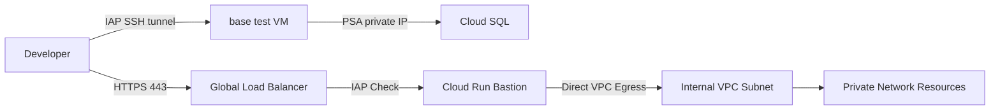
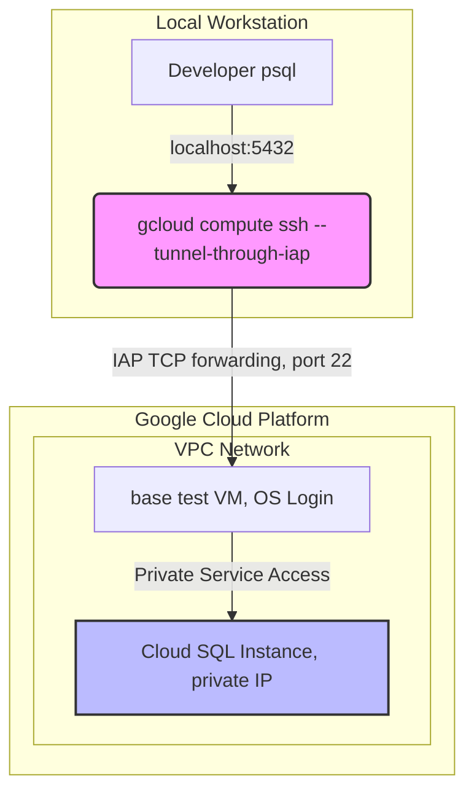

# Cloud Run Bastion (Tinyproxy HTTP Proxy + IAP)

> [📚 Consulter la documentation Terraform auto-générée (TFDOCS.md)](./TFDOCS.md)

Ce module déploie un **bastion HTTP Proxy industriel** s'appuyant sur **Tinyproxy**, sécurisé par **Identity-Aware Proxy (IAP)**.
Il est exposé via un **HTTPS Load Balancer** (GCLB) avec un domaine **Cloud Endpoints** managé (`.cloud.goog`).

> [!IMPORTANT]
> IAP utilise un **client OAuth géré par Google** (aucun `google_iap_client` : l'IAP OAuth Admin API a été arrêtée le 19 mars 2026, voir [IAP deprecations](https://cloud.google.com/iap/docs/deprecations)). Ce client n'accepte que les **utilisateurs de l'organisation** du projet et **ne permet pas d'accès programmatique** ([custom OAuth configuration](https://cloud.google.com/iap/docs/custom-oauth-configuration)) : un script doit présenter un JWT signé par un compte de service, comme le fait `alb-internal`.

## 🏗️ Architecture



## 🚀 Getting Started

### 1. Préparation du projet
Assurez-vous d'avoir configuré votre fichier `.env` à la racine et initialisez les ressources de base (Bucket GCS, Artifact Registry) :
```bash
cp ../../.env.example ../../.env
# Renseigner PROJECT_ID, REGION (europe-west9 recommandé), etc.

# Créer les ressources de bootstrap (uniquement la première fois)
task setup
```

### 2. Build et Push de l'image
L'image du bastion doit être disponible dans Artifact Registry avant le déploiement Cloud Run. Terraform résout le tag `bastion:latest` en son digest (`data.google_artifact_registry_docker_image`) : chaque nouveau push déploie une nouvelle révision au prochain `task apply`.
```bash
# Build (via Podman/Docker) et push vers Artifact Registry
task build
```

### 3. Déploiement automatisé
Utilisez `Task` pour orchestrer le cycle de vie Terraform :

```bash
# Déploiement complet (init + apply)
task apply
```

Une fois déployé, récupérez l'URL sécurisée :
```bash
BASTION_URL=$(cd infra && terraform output -raw bastion_url)
echo "Bastion accessible sur : $BASTION_URL"
```

### 4. Build & Test en Local (Debug)
Vous pouvez tester le fonctionnement du proxy Tinyproxy localement :

```bash
# 1. Build de l'image Docker localement
task build

# 2. Lancer le container sur localhost:1080 (mappé sur le port 8080 du conteneur)
# Terminal 1
task bastion-run

# 3. Tester le proxy HTTP (Terminal 2)
task test-local
```

---

## 🧪 Testing the Bastion

### Contrôle IAP
Sans session IAP, le Load Balancer redirige vers la connexion Google (aucune requête n'atteint Cloud Run) :

```bash
BASTION_URL=$(cd infra && terraform output -raw bastion_url)
curl -sI "$BASTION_URL" | head -1   # attendu : HTTP/2 302 (redirection vers accounts.google.com)
```

Le service Cloud Run n'accepte que l'agent de service IAP comme invocateur (`roles/run.invoker`) : un appel direct à l'URL `run.app`, ou depuis le VPC sans passer par IAP, est refusé.

> [!CAUTION]
> **Limitation technique** : le Global Load Balancer termine HTTP et ne relaie ni la méthode `CONNECT` ni les requêtes de proxy en forme absolue. Le bastion n'est donc **pas un tunnel TCP** (`psql`, SSH) ni un proxy HTTP générique pour un client distant ; `gcloud run services proxy` est aussi refusé par l'ingress `INTERNAL_LOAD_BALANCER`. Pour la base de données, utilisez le tunnel IAP ci-dessous.

## 🗄️ Database Connectivity

L'instance Cloud SQL n'a **pas d'IP publique** (`ipv4_enabled = false`) : elle n'est joignable que par son IP privée (Private Service Access) depuis le VPC de `base`. Depuis un poste local, `task db-proxy` ouvre un **tunnel SSH via IAP** vers la VM de test `vm-test-a<suffix>` de `samples/base` et redirige `localhost:5432` vers l'IP privée de l'instance.

### 📐 Architecture & Security



**Security Enforcement Layers:**
1.  **IAM Authentication**: IAP TCP forwarding (`roles/iap.tunnelResourceAccessor`) and OS Login on the VM; the task runs as the operator, not `sa-iac`.
2.  **No Public IP**: the instance has `ipv4_enabled = false` and no authorized network.
3.  **Encryption**: `ssl_mode = ENCRYPTED_ONLY`, so `psql` negotiates TLS inside the SSH tunnel.
4.  **Network Isolation**: In-cloud traffic (Cloud Run -> SQL) stays entirely within the private Google network via **Private Service Access (PSA)**.

### 🚀 Step-by-Step Connection

`samples/base` must be applied with the same `name_suffix` and `REGION` (its test VM is the jump host).

#### Step 1: Start the Tunnel
In your first terminal, launch the tunnel task:
```bash
task db-proxy
```

#### Step 2: Run the Query
In a second terminal, execute the following command (which dynamically retrieves the password):
```bash
# Retrieve password and execute psql via the tunnel
DB_PASS=$(cd infra && terraform output -raw db_password) && \
PGPASSWORD=$DB_PASS psql "host=127.0.0.1 port=5432 user=testuser dbname=testdb sslmode=require" -c "SELECT version();"
```

---

## 🛠️ Task Commands

| Command | Description |
|---|---|
| `task setup` | Prépare le Bucket TF State et le repo Artifact Registry |
| `task build` | Build l'image Docker (Podman linux/amd64) et push sur Artifact Registry |
| `task init` | Initialise Terraform avec le backend GCS |
| `task plan` | Affiche le plan d'exécution Terraform |
| `task apply` | Déploie l'intégralité de l'infrastructure |
| `task test` | Exécute les tests unitaires Terraform hors-ligne (`mock_provider`, aucun credential GCP) |
| `task bastion-run` | Lance le container en local pour debug |
| `task test-local` | Teste le proxy local via curl |
| `task db-proxy` | Ouvre un tunnel SSH IAP (`localhost:5432`) vers l'IP privée de l'instance Cloud SQL, via la VM de test de `base` |
| `task review` | Exécute pre-commit sur tous les fichiers |
| `task destroy` | Supprime toutes les ressources provisionnées |

---

## 🛡️ Industrial Features

- **HTTP Proxy via Tinyproxy** : proxy HTTP ; la méthode `CONNECT` n'est pas relayée par le GCLB (voir la limitation ci-dessus).
- **Zéro Accès Public Direct** : Ingress configuré en `INTERNAL_LOAD_BALANCER`. Seul le GCLB (après passage IAP) peut l'atteindre.
- **Identity-Aware Proxy** : Authentification centralisée via IAM (`roles/iap.httpsResourceAccessor`), client OAuth géré par Google ; seul l'agent de service IAP peut invoquer Cloud Run.
- **Managed DNS & SSL** : Utilisation de **Cloud Endpoints** pour un domaine `.cloud.goog` avec certificat automatique.
- **Direct VPC Egress** : Accès natif aux sous-réseaux privés sans passer par un Serverless VPC Connector (latence réduite).

---

## 🚀 Troubleshooting

### `task apply` échoue sur `google_iap_client` (state existant)
Les versions précédentes du sample créaient un client OAuth IAP. Le `plan` suivant le supprime : si la suppression échoue (API OAuth Admin arrêtée), retirez la ressource du state avec `terraform state rm google_iap_client.bastion_iap_client`, puis relancez `task apply`.

### Échec du démarrage du container (Port 8080)
Cloud Run injecte une variable `$PORT`. Tinyproxy est configuré pour écouter sur le port 8080 (`app/tinyproxy.conf`), aligné sur `container_port`. Si vous utilisez un GCLB personnalisé, vérifiez que le backend pointe sur le bon port.

## 📁 Structure du Projet

- `app/` : Source du proxy (Dockerfile Debian Slim + Tinyproxy).
- `infra/` : Orchestration Terraform structurée par composant (LB, IAP, DNS, SQL).
