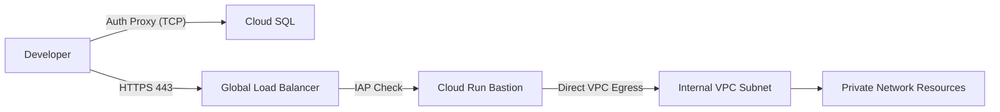
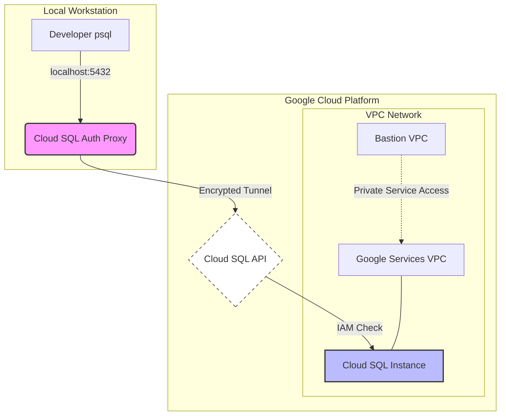

# Cloud Run Bastion (Industrial SOCKS5 Proxy + IAP)

> [📚 Consulter la documentation Terraform auto-générée (TFDOCS.md)](./TFDOCS.md)

Ce module déploie un **bastion HTTP Proxy industriel** s'appuyant sur **Tinyproxy**, sécurisé par **Identity-Aware Proxy (IAP)**.
Il est exposé via un **HTTPS Load Balancer** (GCLB) avec un domaine **Cloud Endpoints** managé (`.cloud.goog`).

## 🏗️ Architecture



## 🚀 Getting Started

### 1. Préparation du projet
Assurez-vous d'avoir configuré votre fichier `.env` à la racine et initialisez les ressources de base (Bucket GCS, Artifact Registry) :
```bash
cp ../../.env.example ../../.env
# Renseigner PROJECT_ID, REGION (europe-west9 recommandé), etc.

# Créer les ressources de bootstrap (uniquement la première fois)
task setup
```

### 2. Build et Push de l'image
L'image du bastion doit être disponible dans Artifact Registry avant le déploiement Cloud Run.
```bash
# Build (via Podman/Docker) et push vers Artifact Registry
task build
```

### 3. Déploiement automatisé
Utilisez `Task` pour orchestrer le cycle de vie Terraform :

```bash
# Déploiement complet (init + apply)
task apply
```

Une fois déployé, récupérez l'URL sécurisée :
```bash
BASTION_URL=$(cd infra && terraform output -raw bastion_url)
echo "Bastion accessible sur : $BASTION_URL"
```

### 4. Build & Test en Local (Debug)
Vous pouvez tester le fonctionnement du proxy Dante localement :

```bash
# 1. Build de l'image Docker localement
task build

# 2. Lancer le container sur localhost:1080 (mappé sur 443 interne)
# Terminal 1
task bastion-run

# 3. Tester le proxy HTTP (Terminal 2)
task test-local
```

---

## 🧪 Testing the Bastion

### Option A : Tunnel local via `gcloud` (Recommandé pour Dev)
Pour utiliser le bastion sans gérer manuellement les tokens OIDC dans vos clients SOCKS5 :

```bash
# Ouvrir le proxy local gcloud (Terminal 1)
# Cela mappe le service Cloud Run distant vers localhost:1080 et gère l'auth IAP
gcloud run services proxy cloudrun-bastion-industrial --port=1080
```

### Option B : Test de connectivité vers la base privée
Dans un autre terminal, testez l'accès à la base PostgreSQL (provisionnée par `sql.tf`) à travers le tunnel :

```bash
# Récupérer l'IP privée de la base de données
DB_IP=$(cd infra && terraform output -raw db_instance_ip)

# Test de connexion via le proxy HTTP (CONNECT)
curl -v -x http://localhost:1080 http://$DB_IP:5432
```

## 🗄️ Database Connectivity

Connecting to the private Cloud SQL instance from your local machine is achieved using the **Cloud SQL Auth Proxy**. This is the industrial standard for secure database access, as it eliminates the need for VPNs or insecure authorized networks.

### 📐 Architecture & Security

The following diagram illustrates the secure path from your terminal to the data:



**Security Enforcement Layers:**
1.  **IAM Authentication**: The proxy requires valid Google Cloud credentials (via `gcloud auth application-default login`).
2.  **Mutual TLS**: The tunnel automatically handles SSL/TLS certificates and rotating ephemeral keys.
3.  **No Public Ingress**: The instance has `ipv4_enabled = true`, but **0.0.0.0/0 is NOT authorized**. Only the authenticated Proxy can create a tunnel.
4.  **Network Isolation**: In-cloud traffic (Cloud Run -> SQL) stays entirely within the private Google network via **Private Service Access (PSA)**.

### 🚀 Step-by-Step Connection

To query your database, follow these two steps in separate terminal windows:

#### Step 1: Start the Tunnel
In your first terminal, launch the proxy task:
```bash
task db-proxy
```
*Expected output: `The proxy has started successfully and is ready for new connections!`*

#### Step 2: Run the Query
In a second terminal, execute the following command (which dynamiclly retrieves the password):
```bash
# Retrieve password and execute psql via the tunnel
DB_PASS=$(cd infra && terraform output -raw db_password) && \
PGPASSWORD=$DB_PASS psql -h 127.0.0.1 -p 5432 -U testuser -d testdb -c "SELECT version();"
```

**Success Output:**
```text
                                         version                                          
------------------------------------------------------------------------------------------
 PostgreSQL 15.17 on x86_64-pc-linux-gnu, compiled by Debian clang version 12.0.1, 64-bit
(1 row)
```

### Option C : Test de connectivité HTTP
```bash
# Récupérer l'IP privée d'une ressource interne
INTERNAL_IP="10.x.x.x"
curl -v -x http://localhost:1080 http://$INTERNAL_IP
```

> [!CAUTION]
> **Limitation Technique** : Le Global Load Balancer (GCLB) et IAP bloquent la méthode `HTTP CONNECT`. Le bastion Cloud Run ne peut donc pas être utilisé comme un "bridge" TCP générique pour des clients comme `psql` sans encapsulation Websocket (non implémenté ici). Utilisez le **Cloud SQL Auth Proxy** pour tout accès BDD.

---

## 🛠️ Task Commands

| Command | Description |
|---|---|
| `task setup` | Prépare le Bucket TF State et le repo Artifact Registry |
| `task build` | Build l'image Docker (Podman linux/amd64) et push sur Artifact Registry |
| `task init` | Initialise Terraform avec le backend GCS |
| `task plan` | Affiche le plan d'exécution Terraform |
| `task apply` | Déploie l'intégralité de l'infrastructure |
| `task test` | Exécute les tests unitaires Terraform |
| `task bastion-run` | Lance le container en local pour debug |
| `task test-local` | Teste le proxy local via curl |
| `task review` | Exécute pre-commit sur tous les fichiers |
| `task destroy` | Supprime toutes les ressources provisionnées |

---

## 🛡️ Industrial Features

- **HTTP Proxy via Tinyproxy** : Utilisation de la méthode `CONNECT` pour un tunneling TCP robuste sur HTTP (compatible gcloud/IAP).
- **Zéro Accès Public Direct** : Ingress configuré en `INTERNAL_LOAD_BALANCER`. Seul le GCLB (après passage IAP) peut l'atteindre.
- **Identity-Aware Proxy** : Authentification centralisée via IAM (`roles/iap.httpsResourceAccessor`).
- **Managed DNS & SSL** : Utilisation de **Cloud Endpoints** pour un domaine `.cloud.goog` avec certificat automatique.
- **Direct VPC Egress** : Accès natif aux sous-réseaux privés sans passer par un Serverless VPC Connector (latence réduite).

---

## 🚀 Troubleshooting

### Erreur `google_iap_brand`
Si vous recevez l'erreur `Error 400: Request contains an invalid argument` lors de la création de la ressource `google_iap_brand` :
> Un seul écran de consentement OAuth (Brand) est autorisé par projet Google Cloud. Si un écran a déjà été configuré manuellement ou par un autre déploiement, vous devez soit importer la ressource existante dans Terraform, soit la gérer en dehors du cycle de vie Terraform (en utilisant une `data` source ou en commentant la ressource).

### Échec du démarrage du container (Port 8080)
Cloud Run injecte une variable `$PORT`. Le serveur Dante est configuré pour écouter sur le port 8080. Si vous utilisez un GCLB personnalisé, vérifiez que le backend pointe sur le bon port.

### Erreur de résolution d'interface (eth0)
Dans Cloud Run Gen2, l'interface `eth0` n'est pas toujours disponible. Le bastion utilise un script `startup.sh` qui détecte dynamiquement l'interface de sortie (`ip route`) avant de lancer Dante.

## 📁 Structure du Projet

- `app/` : Source du proxy (Dockerfile Debian Slim + Tinyproxy).
- `infra/` : Orchestration Terraform structurée par composant (LB, IAP, DNS, SQL).
