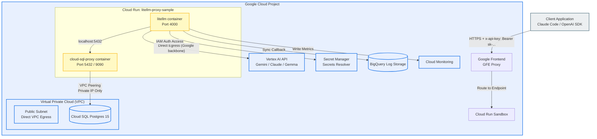

# 🚀 LiteLLM Proxy on Cloud Run

> [📚 Terraform auto-generated documentation (TFDOCS.md)](./TFDOCS.md)

OpenAI-compatible gateway for Google Vertex AI (Gemini, Claude, Gemma) featuring **per-user Virtual API Keys**, running securely on Google Cloud Run. Virtual Keys are backed by a private Cloud SQL PostgreSQL database, and all network connections transit via a secure VPC public subnet with direct egress.

---

## 🏗️ Architecture



> [!TIP]
> **Draw.io Diagram:** A professional, fully detailed draw.io architecture diagram with standard GCP icons is available at [architecture.drawio](file:///Users/adrien/workspace/cloud/gcp-samples/samples/cloudrun-litellm-proxy/architecture.drawio). Open it in [draw.io](https://app.diagrams.net/) to inspect or edit the visual enterprise components.

### 🧰 Key Design Decisions

| Component | Design Details |
|---|---|
| **Network Security** | Direct VPC Egress enabled on `base.subnet_public`. Ingress set to `INGRESS_TRAFFIC_ALL`. Egress configured as `PRIVATE_RANGES_ONLY` — ensuring all connections to Vertex AI and Cloud SQL (via private IP) stay on Google's private backbone network rather than traveling over the public internet. |
| **Authentication** | Two-layer model: **LiteLLM Virtual Keys** (`sk-...`) act as the application gate. IAM is kept open (`allUsers invoker`) so any developer client can hit the proxy without a GCP identity. Since Google Frontend (GFE) strips standard `Authorization: Bearer` headers, we use a custom `x-api-key` header to bypass GFE validation. |
| **Per-User Virtual Keys** | Generated dynamically via `POST /key/generate` (authorized by `LITELLM_MASTER_KEY`). Every key has a configurable `max_budget`, `budget_duration`, allowed `models` list, and custom `user` metadata. Keys are persisted in Cloud SQL. |
| **Private Cloud SQL** | PostgreSQL 15 deployed with **Private IP only** (`ipv4_enabled = false`). SSL enforced (`ENCRYPTED_ONLY`). A `cloud-sql-proxy` sidecar handles secure mTLS + IAM-authenticated connectivity. Daily backups with 7-day retention and Point-In-Time Recovery (PITR) enabled. |
| **Secret Management** | Sensitive variables (`LITELLM_MASTER_KEY` and `DATABASE_URL`) are stored in **Secret Manager**. The Master Key is seeded out-of-band so it never leaks into the Terraform state. |
| **Inference Regions** | **Gemini & Claude** → `europe-west9`. **Gemma** → `europe-west4` (Vertex AI Model Garden GPU endpoint). |

---

## 📋 Prerequisites

1. The `base` sample must be applied first (VPC, subnet, and GCS tfstate bucket created).
2. Google Vertex AI APIs enabled with EU multi-region access for Gemini and Claude models.
3. Root `.env` populated with your `PROJECT_ID` and `REGION`.
4. **Gemma only:** request Model Garden access for `google/gemma3` in `europe-west4` or deploy the model to a GPU endpoint in that region.

---

## 🚀 Deployment

Execute these steps in your terminal to build, provision, and deploy the entire stack:

```bash
# 1. Generate and seed a valid sk- prefixed admin master key (never stored in TF state)
task seed-key

# 2. Build and push the LiteLLM container image to Artifact Registry
task build

# 3. Provision Cloud SQL, Cloud Run service, secrets, and optional DNS
task apply

# 4. Run the end-to-end integration smoke test
task smoke
```

Additionally, Terraform provides a `curl_test_command` output containing a shell script to quickly verify that the service's liveness endpoint is reachable:
```bash
$(terraform output -raw curl_test_command)
```

> [!NOTE]
> **Cloud SQL Importing:** The private service connection (`google_service_networking_connection`) operates on the shared `base` VPC. If another sample already created it, import it manually:
> ```bash
> terraform import google_service_networking_connection.private_vpc_connection \
>   projects/PROJECT_ID/global/networks/NETWORK_NAME:servicenetworking.googleapis.com
> ```

---

## 🔑 Managing Virtual Keys

Virtual keys are managed by hitting the admin endpoints of the proxy using your **Admin Master Key** passed in the `x-api-key: Bearer ...` header.

```bash
# 1. Fetch the master key and service URL
SERVICE_URL=$(cd infra && terraform output -raw service_url)
MASTER_KEY=$(gcloud secrets versions access latest --secret=litellm-master-key-sample)

# 2. Create a virtual key for user alice with a 7-day budget cycle of 10€
task provision-key USER=alice MAX_BUDGET=10

# Or call the Admin API directly to generate a key with a 7-day budget cycle:
curl -sS -X POST "${SERVICE_URL}/key/generate" \
  -H "x-api-key: Bearer ${MASTER_KEY}" \
  -H "Content-Type: application/json" \
  -d '{
    "key_alias": "alice",
    "max_budget": 10,
    "budget_duration": "7d",
    "models": ["gemini-2.5-flash", "gemini-2.5-pro", "claude-opus-4-7", "claude-sonnet-4-6", "claude-haiku-4-5", "gemma-3-27b"],
    "metadata": {"user": "alice", "team": "backend"}
  }' | jq .

# 3. List all virtual keys with their human-readable aliases, owners, and spend details:
for hash in $(curl -sS "${SERVICE_URL}/key/list" -H "x-api-key: Bearer ${MASTER_KEY}" | jq -r '.keys[]'); do
  curl -sS "${SERVICE_URL}/key/info?key=${hash}" -H "x-api-key: Bearer ${MASTER_KEY}" | jq -c '{alias: .info.key_alias, user: .info.metadata.user, key_name: .info.key_name, spend: .info.spend, max_budget: .info.max_budget}'
done

# 4. Delete a key
curl -sS -X DELETE "${SERVICE_URL}/key/delete" \
  -H "x-api-key: Bearer ${MASTER_KEY}" \
  -H "Content-Type: application/json" \
  -d '{"keys": ["sk-..."]}' | jq .
```

---

## 📡 Calling the Proxy (as a user)

Clients connect to the OpenAI-compatible proxy by sending their assigned Virtual Key in the `x-api-key: Bearer <key>` custom header.

```bash
# 1. Load your connection details
SERVICE_URL=$(cd infra && terraform output -raw service_url)
USER_KEY="sk-..."  # Replace with your issued virtual key

# 2. Call the chat completions endpoint via curl
curl -sS -X POST "${SERVICE_URL}/v1/chat/completions" \
  -H "x-api-key: Bearer ${USER_KEY}" \
  -H "Content-Type: application/json" \
  -d '{
    "model": "gemini-2.5-flash",
    "messages": [{"role": "user", "content": "Say hi!"}],
    "stream": true
  }'
```

---

## 🔌 Getting Started with Client Integrations

You can easily configure your local agentic coding tools and CLI utilities to run completely against your hosted LiteLLM Proxy.

> [!TIP]
> **Detailed setup guides** are available in the [`docs/`](./docs/) folder:
> - 🤖 [Claude Code setup guide](./docs/setup-claude-code.md) — VS Code extension + CLI
> - ✨ [Gemini CLI & Antigravity CLI setup guide](./docs/setup-gemini-cli.md)

### 1. Claude Code 🤖
`claude-code` communicates standardly using the Anthropic API structure (which LiteLLM translates to Vertex AI Claude) and authenticates using the `x-api-key` header. Since we configured our LiteLLM proxy to accept custom keys in `x-api-key`, you can connect Claude Code directly with two environment variables:

```bash
# Set your proxy base URL and virtual key in your shell session
export ANTHROPIC_BASE_URL="$(cd infra && terraform output -raw service_url)"
export ANTHROPIC_API_KEY="sk-..."  # Your issued LiteLLM virtual key

# Run Claude Code in your workspace!
claude
```

### 2. OpenAI Python SDK 🐍
To call the proxy from any standard Python script using the modern `openai` client library, pass the `x-api-key` custom header in the client creation options:

```python
import openai

# Initialize client pointing to your Cloud Run service URL
client = openai.OpenAI(
    base_url="$(cd infra && terraform output -raw service_url)/v1",
    default_headers={"x-api-key": "Bearer sk-..."}, # custom key header
)

response = client.chat.completions.create(
    model="gemini-2.5-flash",
    messages=[{"role": "user", "content": "Hello LiteLLM!"}],
)
print(response.choices[0].message.content)
```

## DNS setup

When `var.dns_name` is set, Terraform creates a Cloud DNS managed zone and CNAME record.
After `terraform apply`, delegate the domain to Cloud DNS:

```bash
# Get the name servers
terraform output dns_name_servers

# At your registrar, update NS records for the subdomain's parent zone to these servers.
# Certificate provisioning by Cloud Run may take 15-30 minutes.
```

## Observability

LiteLLM logs every completed request to **BigQuery** via `success_callback: ["bigquery"]`. Each row captures model, input/output tokens, cost (USD), latency, user alias, and key alias.

### Query token & cost usage

```bash
# Shortcut (uses bq CLI)
task query-spend

# Or query directly
bq query --project_id=PROJECT_ID --use_legacy_sql=false '
SELECT
  DATE(created_at)        AS day,
  model,
  key_alias,
  SUM(input_tokens)       AS read_tokens,
  SUM(output_tokens)      AS write_tokens,
  ROUND(SUM(spend), 6)    AS cost_usd,
  ROUND(AVG(response_ms)) AS avg_latency_ms
FROM `PROJECT_ID.litellm_observability.litellm_logs`
WHERE created_at >= TIMESTAMP_SUB(CURRENT_TIMESTAMP(), INTERVAL 7 DAY)
GROUP BY 1, 2, 3
ORDER BY day DESC, cost_usd DESC
LIMIT 50'
```

### Cloud Monitoring dashboard

Terraform provisions a **Cloud Monitoring dashboard** with four tiles: request rate, P50/P99 latency, instance count, and a SQL reference for the BigQuery analytics. After `task apply`:

```bash
cd infra && terraform output -raw dashboard_url
```

> Token/cost time-series are best explored in [Looker Studio](https://lookerstudio.google.com) connected to the `litellm_observability.litellm_logs` BigQuery table.

## FinOps

| Item | Estimated idle cost (EUR/month) |
|---|---|
| Cloud Run (min=1, 1 vCPU) | ~12–18 |
| Cloud SQL db-f1-micro | ~7–10 |
| BigQuery (storage + queries) | ~1–3 |
| Artifact Registry | <1 |
| Secret Manager (2 secrets) | <1 |
| Cloud DNS managed zone | ~0.20 |
| Logging / Monitoring | usage-based |
| **Total idle** | **~21–33** |

Set `min_instances=0` and `cloudsql_tier=db-f1-micro` to minimise idle cost. Set `var.dns_name=""` to skip DNS resources entirely.

## Project structure

```text
cloudrun-litellm-proxy/
├── app/
│   ├── Dockerfile               # pinned LiteLLM v1.52.0
│   └── config.yaml              # models + database_url + store_model_in_db=false
├── docs/
│   ├── setup-claude-code.md     # Claude Code CLI + VS Code extension setup guide
│   └── setup-gemini-cli.md      # Gemini CLI + Antigravity CLI setup guide
├── infra/
│   ├── providers.tf             # google ~> 6.0, random ~> 3.6
│   ├── variables.tf             # project_id, region, dns_name, cloudsql_tier, ...
│   ├── main.tf                  # APIs, base remote state, DNS locals
│   ├── iam.tf                   # runner SA + least-privilege bindings (two-layer auth)
│   ├── secrets.tf               # master_key + database_url secrets
│   ├── artifact_registry.tf     # Docker repo
│   ├── cloudsql.tf              # random_password, VPC peering, Postgres module (SSL enforced)
│   ├── cloudrun.tf              # Cloud Run v2 + Cloud SQL Auth Proxy sidecar
│   ├── bigquery.tf              # BigQuery dataset + litellm_logs table (partitioned by day)
│   ├── observability.tf         # Cloud Monitoring dashboard (request rate, latency, instances)
│   ├── dns.tf                   # managed zone + CNAME (count = create_dns)
│   ├── domain_mapping.tf        # Cloud Run domain mapping (count = create_dns)
│   └── outputs.tf
├── architecture.drawio          # Professional GCP architecture diagram (draw.io)
├── Taskfile.yml                 # setup, seed-key, build, init, plan, apply, provision-key, smoke, destroy
└── README.md
```

## Deferred

- **Redis (Memorystore)** — shared in-memory cache and rate-limit counters across instances (~35 EUR/month).
- **Looker Studio dashboard** — connect `litellm_observability.litellm_logs` to Looker Studio for per-user/model cost breakdown with charts.
- **Alerting** — `google_monitoring_alert_policy` on cost spikes or error-rate thresholds.
- **Multi-region** — parameterise `var.region` for other Vertex-compatible regions.
- **CI/CD** — GitHub Actions pipeline for image build + `task apply` on merge.
