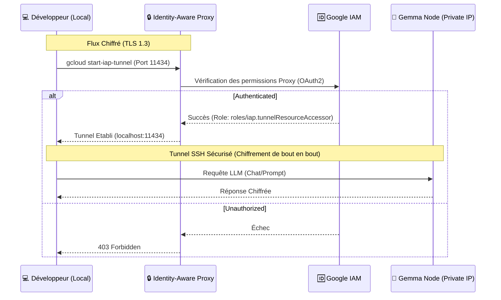

# Google Cloud (GCP) Deployment - Gemma LLM

Ce répertoire contient les fichiers Terraform pour déployer le modèle **Gemma 4 26B** sur Google Compute Engine (GCE) avec des GPUs NVIDIA L4.

## 🏗 Architecture & Sécurité (Security by Design)

L'infrastructure est conçue selon les principes de **Privilège Minimum** et de **Zero Trust**.

- **Isolation Réseau** : L'instance réside dans un sous-réseau privé sans adresse IP publique. Toute sortie vers internet pour les mises à jour passe par un **Cloud NAT**.
- **Accès Sécurisé (IAP)** : Les connexions (SSH et API Ollama) s'effectuent exclusivement via un tunnel **Identity-Aware Proxy (IAP)**. Cela élimine le besoin de firewall ouvert sur le monde et d'IP publique.
- **Identité & IAM** : L'instance utilise un Service Account dédié (`llm-instance-sa`) avec des rôles granulaires pour le logging, le monitoring et l'accès au tunnel.
- **Chiffrement** : Les flux sont chiffrés de bout en bout (Tunnel TLS via IAP).

### Schéma des Flux (Authentification & Chiffrement)



## 💰 Comparatif FinOps & Performance

Le choix de l'instance dépend de la complexité du modèle (VRAM) et de la réactivité souhaitée. Les chiffres ci-dessous sont estimés pour la région `europe-west4`.

| Modèle | Instance | GPU | VRAM Req. (4-bit) | Vitesse Est. | Coût On-Demand | Coût Spot |
| :--- | :--- | :--- | :--- | :--- | :--- | :--- |
| **Gemma 4 26B** | g2-standard-4 | 1x L4 (24GB) | ~15 GB | **20-25 t/s** | ~$0.85 /h | ~$0.25 /h |
| **Gemma 4 26B** | g2-standard-8 | 1x L4 (24GB) | ~15 GB | **22-27 t/s** | ~$1.10 /h | ~$0.33 /h |
| **Qwen 2.5 32B** | g2-standard-4 | 1x L4 (24GB) | ~18 GB | **15-20 t/s** | ~$0.85 /h | ~$0.25 /h |
| **Qwen 2.5 32B** | g2-standard-8 | 1x L4 (24GB) | ~18 GB | **18-23 t/s** | ~$1.10 /h | ~$0.33 /h |

> [!TIP]
> **Optimisation FinOps** : L'utilisation de **Spot VMs** est recommandée pour économiser jusqu'à **70%** des coûts. Pour le développement, `g2-standard-4` est suffisant car le bottleneck est principalement le GPU L4, pas le CPU/RAM hôte.

## ⚠️ Demandes de Quotas (PRÉ-REQUIS)

Le déploiement échouera si vous n'avez pas les quotas GPU nécessaires.

1. Allez dans **IAM & Admin > Quotas**.
2. Recherchez `compute.googleapis.com/gpus_all_regions`.
3. Cliquez sur **ÉDITER LES QUOTAS** et demandez une augmentation à **1**.

## 🚀 Déploiement

### 1. Configuration
Éditez `../../.env` à la racine du projet avec votre `PROJECT_ID`. La région et la zone GPU sont fixées dans `Taskfile.yml` (`GPU_REGION=europe-west4`, `GPU_ZONE=europe-west4-a`) : le `REGION` de la racine (`europe-west9`) n'est pas utilisé par ce sample.

### 2. Initialisation & Livraison
```bash
task setup   # Crée le bucket GCS pour le remote state
task apply   # Déploie l'infrastructure
```

## 🔌 Accès & Utilisation

### Tunnel Sécurisé (IAP)
L'instance n'a pas d'IP publique. Utilisez IAP pour vous connecter :
```bash
task tunnel
```
> [!IMPORTANT]
> Ce tunnel est **obligatoire** pour connecter vos outils (CLI, IDE) à votre LLM privé. Gardez ce terminal ouvert pendant l'utilisation.

### SSH sur l'instance
```bash
task ssh
```

### Utilisation de la CLI (gemma-cli.sh)
Un script wrapper est disponible pour interagir rapidement avec le modèle via le tunnel :
```bash
# Mode rapide (par défaut)
./gemma-cli.sh "Quelle est la capitale de la France ?"

# Mode réflexion (Température basse, plus de précision)
./gemma-cli.sh thinking "Analyse ce bloc de code pour des vulnérabilités SQLi..."
```
> [!NOTE]
> Le script affiche automatiquement les métriques de performance (**Tokens/sec**, temps d'exécution).

### Logs de démarrage
Si vous rencontrez des problèmes avec l'installation des drivers, consultez les logs de l'instance :
```bash
gcloud compute ssh gemma-node --command "sudo journalctl -u google-startup-scripts.service" --tunnel-through-iap --project ${PROJECT_ID} --zone europe-west4-a
```

## 🗑 Nettoyage
```bash
task destroy
```
